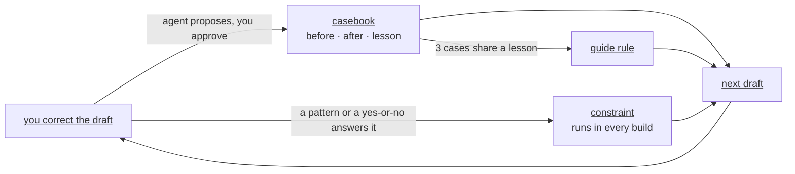

# How it learns



## Where a correction goes

When a job ends, the agent proposes a destination for each correction worth keeping, and you accept, rephrase or decline. It asks four questions in order:

1. Can a pattern decide it? It becomes a **regex constraint**.
2. Can a reader answer yes or no after reading the sentence and its source? It becomes a **probe**.
3. Is it a matter of degree, a tendency of your voice? It becomes a **rule** in a guide.
4. Is it a concrete illustration of one of these? It becomes a **case**.

A correction with an exact answer should not stay a case, because a constraint is enforced on every build while a case only informs a draft.

## Cases

A case is one concrete fix, with a hook that says when it applies:

```
hook:    a contribution that restates the method
problem: contributions restated the method instead of what it enables
before:  We propose AcmeTrees, a tool that aggregates rules...
after:   AcmeTrees lets an analyst inspect a fitted ensemble without a surrogate...
lesson:  a contribution states what the reader can now do
```

The agent sees only the hooks of the cases that concern the topics it loads, one line each, and opens the ones that apply with `parla case show c-0012` ([casebook](../../specs/casebook.md)).

## Constraints

A constraint lives outside the prompt and runs in `parla check` and `parla build`, on the lines the job changed. A regex constraint is decided by the tool. A probe is a question the tool locates, such as every sentence with a citation, and the agent answers it by reading the source:

```
$ parla check my-paper          # output abridged
section/introduction.tex:3: error constraint/fig-ref-form: a figure is referenced as Figure~\ref{fig:<id>}, with the id of its label: "See Figure~\ref{results}. The model reaches 91.2 accuracy..." (key fig-ref-form#24032e)
section/introduction.tex:3: probe constraint/cite-grounded: the cited source supports the claim at the strength written
    key: cite-grounded#302fbc
suite: 2 fail, 2 probes open, 0 resolved

$ parla check my-paper --resolve cite-grounded#302fbc --pass --evidence "<a line from the paper>"
```

The suite is green when no failure and no open probe remains. A regex constraint comes with a sentence it must match and one it must not, so it is tested when you add it. Constraints are described in [constraints](../../specs/constraints.md). Add your own with `parla constraint add`, and `parla constraint list` shows the starter set that ships with the package.

## Rules

`parla case lint` reports when three cases share a topic and an audience. The agent then proposes a rule for your guides with the cases as evidence, and you decide whether it goes in. The cases stay as examples of the rule.

Rules stay atomic, one instruction each, and the guide stays inside its size budget. When a lesson refines a rule, the agent proposes rewriting that rule with `parla guide edit` instead of adding a sibling. When rules overlap, it proposes merging them into one, and a rule that a constraint now enforces is dropped with `parla guide drop`. Every edit and drop keeps the old wording in `rules.history.jsonl`, so nothing is lost.

## The four memories

| Memory | Holds | Changes |
|---|---|---|
| Guides | your stable rules, on top of the shipped defaults | slowly |
| Constraints | patterns and questions with an exact answer | when a correction has an exact answer |
| Casebook | your corrections, each with a hook, a before, an after and a lesson | every job |
| Card | the decisions of one artifact: claim strength, scope, which result leads | per artifact |

Your rules append to the shipped defaults and win over them ([guides](../../specs/guides.md#merge)). The agent writes to any of these only after you accept the exact wording. A decision about what to say goes to the card, and neither a case, a rule nor a constraint records it.

Your guides, constraints and casebook are plain files in your private root, `~/.config/parla` by default. You can read them, edit them and keep them in your own version control. Inspect them with `parla guide list`, `parla constraint list` and `parla case list`, and see where each line of a prompt comes from with `parla guide show <artifact> <part> --outline`.
